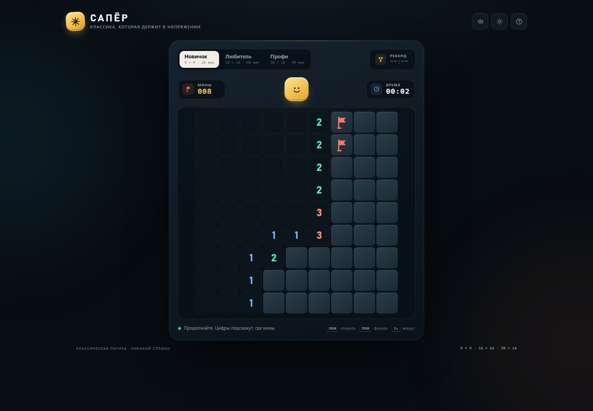

# Сапёр

Классическая логическая игра в браузере: поле с минами, флажки, таймер и личные рекорды. Сделано как один самодостаточный HTML-файл — без сборки, сервера и внешних зависимостей.

## Запуск

Откройте `index.html` в любом современном браузере. Можно просто дважды кликнуть по файлу.

## Возможности

- три уровня сложности: **Новичок** 9 × 9 (10 мин), **Любитель** 16 × 16 (40 мин), **Профи** 30 × 16 (99 мин);
- безопасный первый ход: мины расставляются после открытия первой клетки;
- флажки, открытие соседних клеток по цифре, таймер и счётчик мин;
- победа и поражение с итоговой карточкой;
- личные рекорды и настройки сохраняются в `localStorage`;
- тёмная и светлая темы;
- звуковые эффекты с возможностью отключения;
- управление мышью, клавиатурой и долгим нажатием на сенсорных экранах;
- адаптивная вёрстка с горизонтальной прокруткой больших полей на телефонах;
- доступная навигация по полю стрелками и подписи клеток для скринридеров.

## Управление

| Действие | Мышь / клавиатура | Телефон |
| --- | --- | --- |
| Открыть клетку | левая кнопка | касание |
| Поставить флажок | правая кнопка или `F` | долгое нажатие |
| Открыть соседние клетки вокруг цифры | клик по открытой цифре при совпадении числа флажков | касание цифры |
| Новая игра | `R` или кнопка-смайлик | кнопка-смайлик |
| Правила | `H` | кнопка «?» |
| Звук | `M` | кнопка динамика |
| Перемещение по полю | стрелки | — |

## Технологии

Чистые HTML, CSS и JavaScript. Игра, оформление, анимации и звук синтезируются прямо в браузере, без сторонних библиотек и сетевых запросов.
